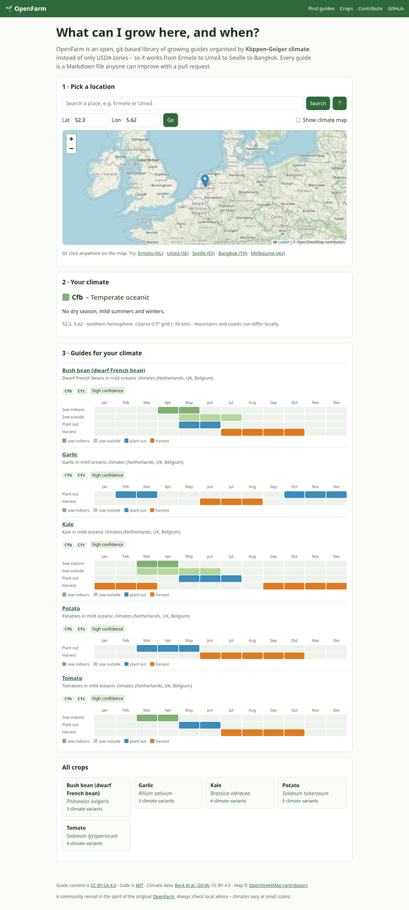
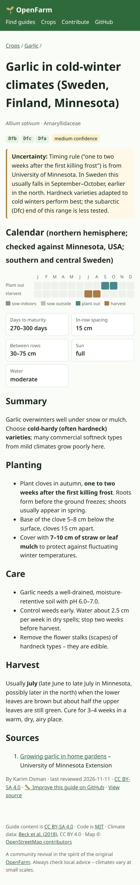

# 🌱 OpenFarm

**Open, git-based, climate-aware growing guides for every garden on Earth.**

👉 Live demo: **https://karimogit.github.io/OpenFarm/**

Pick a place on the map (or search, or type lat/lon) → OpenFarm looks up its
**Köppen-Geiger climate class** offline in your browser → you get the guides written
for that climate and a month-by-month planting calendar. No accounts, no backend,
no tracking.

| | |
|---|---|
|  |  |

## Why

Most planting calendars are written for one country, and most "zone" systems
(USDA hardiness zones) describe only winter cold. A gardener in the Netherlands, in
Umeå, in Seville and in Bangkok needs completely different advice for the same crop,
and the differences come from the *whole* climate: summer heat, dry seasons and
season length. The Köppen-Geiger classification captures exactly that and covers the
whole planet, so it works as a shared key for organising guides worldwide.

## What's in this repository

```
content/guides/<crop>/<variant>.md   Growing guides: YAML frontmatter + Markdown  (CC BY-SA 4.0)
content/TEMPLATE.md                  Template for new guides
schema/guide.schema.json             JSON Schema for the frontmatter – validated in CI
data/koppen/                         Köppen-Geiger 0.5° grid, Beck et al. 2018 (CC BY 4.0)
scripts/validate.js                  Schema + cross-file checks (npm run validate)
scripts/build_koppen.py              Builds the 25 kB climate lookup + map overlay
site/                                Eleventy templates, CSS and a small vanilla-JS app (MIT)
.github/workflows/                   CI validation + GitHub Pages deploy
```

**Today:** 5 crops (tomato, potato, garlic, kale, bush bean) × 19 climate variants
covering temperate oceanic (Cfb – e.g. Netherlands), cold continental and subarctic
(Dfb/Dfc – e.g. Sweden), Mediterranean (Csa/Csb) and tropical wet–dry (Aw/Am).
Every guide cites public sources (RHS, University of Minnesota Extension,
University of California ANR, UF/IFAS, Jordbruksverket and others) and carries an
honest `confidence` rating and `uncertainty` note.

### Guide format

```yaml
crop: potato
common_name: Potato
scientific_name: Solanum tuberosum
family: Solanaceae
variant: temperate-oceanic
koppen: [Cfb, Cfc]
hemisphere: north
reference_location: Netherlands / UK lowlands
calendar: { plant: [3, 4, 5], harvest: [6, 7, 8, 9, 10] }
spacing: { in_row_cm: [30, 37], between_rows_cm: [60, 75] }
sun: full
water: moderate
confidence: high
sources: [{ title: "Potatoes: grow your own", publisher: RHS, url: https://www.rhs.org.uk/vegetables/potatoes/grow-your-own }]
license: CC-BY-SA-4.0
```

Full field reference: [`schema/guide.schema.json`](schema/guide.schema.json) and
[`content/TEMPLATE.md`](content/TEMPLATE.md).

## How this differs from the original OpenFarm

[OpenFarm](https://github.com/openfarmcc) (openfarm.cc), started by Rory Aronson,
was a free and open database of crowd-sourced growing guides. It inspired a lot of
people, including us, and this project would not exist without it. Its lessons shaped
this restart:

- **Content first, not app first.** The original needed a large web app before the
  database could become useful. Here the guides *are* the product: plain files that
  are readable and useful even without the website.
- **Git + Markdown instead of a database.** Every change is a reviewed pull request
  with full history, attribution and easy forking. Anyone can mirror or reuse the
  whole dataset with `git clone`.
- **Climate-based.** Guides are keyed to Köppen-Geiger classes and hemisphere, not
  just USDA zones, so the same crop gets different calendars in Ermelo, Umeå, Seville
  and Bangkok.
- **Sourced and honest.** Every guide links real sources and states its confidence,
  so readers can tell well-tested advice from a first draft.
- **Tiny and cheap to run.** A static site on free hosting – nothing to keep alive,
  no servers to pay for.
- **AI-assisted tooling, human-reviewed content.** Modern tools make it fast to draft
  guides, translate them and build features, but CI validation and human review keep
  quality up.

## Related projects

We'd rather cooperate than compete:

- **[Growstuff](https://www.growstuff.org/)** – a long-running open-source community
  for food gardeners that shares openly licensed crop data. Great for tracking plantings
  and harvests.
- **[OpenPlantDB](https://github.com/cwfrazier1/openplantdb)** – a CC0
  machine-readable garden-plant dataset (germination, maturity, USDA-zone timing).
  Its CC0 data could seed crop facts here, with climate-specific calendars on top.

## Roadmap

- [x] Guide format, JSON Schema and CI validation
- [x] Offline location → Köppen lookup, monthly calendar, mobile-friendly static site
- [x] First 19 sourced guides across 5 crops and 4 climate groups
- [ ] Upgrade climate data to Beck et al. (2023) 1991–2020 at 0.1° (also CC BY 4.0)
- [ ] Native southern-hemisphere variants (instead of the shifted calendar)
- [ ] 50 crops × major climate groups; regional reviewers per climate
- [ ] Translations (Dutch, Swedish, Spanish, …) – the structured format makes this easy
- [ ] Frost-date and day-length hints; climate-change view (2041–2070 Köppen maps)
- [ ] Public JSON export (`/api/guides.json` already exists) and a small API for apps
- [ ] Import openly licensed facts (e.g. OpenPlantDB CC0) with attribution

## Sustainability

- **Hosting costs almost nothing:** a static site on GitHub Pages (or any static host).
  If the project moves to `openfarm.cc`, set `PATH_PREFIX=/` in the deploy workflow.
- **Low maintenance:** no database, no user accounts, no server to patch. If the website
  stopped tomorrow, the guides would still be usable straight from the repository.
- **Community governance:** the guides are reviewed through pull requests, with
  maintainers for each climate region over time.
- **Funding:** small, targeted grants for specific milestones (for example
  [NLnet](https://nlnet.nl/) open-source funding) to pay for content sprints,
  translations and the data upgrade. No ads and no paywall. The content stays
  CC BY-SA, so it can't be closed off.

## Development

```bash
npm ci
npm run validate   # check all guides
npm run dev        # http://localhost:8080/OpenFarm/
npm run build      # validate + build static site into _site/
```

Node 20+. The climate assets in `site/assets/` are committed; rebuild them with
`npm run build:climate` (Python 3 + numpy + pillow) only if the source grid changes.

### Deploying (GitHub Pages)

1. The repository must be **public** (Pages on private repos needs a paid plan).
2. **Settings → Pages → Build and deployment → Source: GitHub Actions.**
3. Push to `main`. The *Deploy to GitHub Pages* workflow publishes the site to
   `https://karimogit.github.io/OpenFarm/`.

## Licenses

- **Code:** [MIT](LICENSE).
- **Guide content** (`content/`): [CC BY-SA 4.0](content/LICENSE). You may reuse and
  adapt it, also commercially, with attribution, under the same license.
- **Climate data:** Beck, H.E. et al. (2018), *Present and future Köppen-Geiger climate
  classification maps at 1-km resolution*, Scientific Data 5:180214,
  [doi:10.1038/sdata.2018.214](https://doi.org/10.1038/sdata.2018.214) –
  [CC BY 4.0](https://creativecommons.org/licenses/by/4.0/). See [`data/koppen/`](data/koppen/README.md).
- **Map tiles and place search:** © [OpenStreetMap](https://www.openstreetmap.org/copyright)
  contributors, via the OSM tile server and Nominatim (used within their usage policies).
- **Leaflet:** BSD-2-Clause.

Advice in the guides is general. Always check local conditions and local advice.
