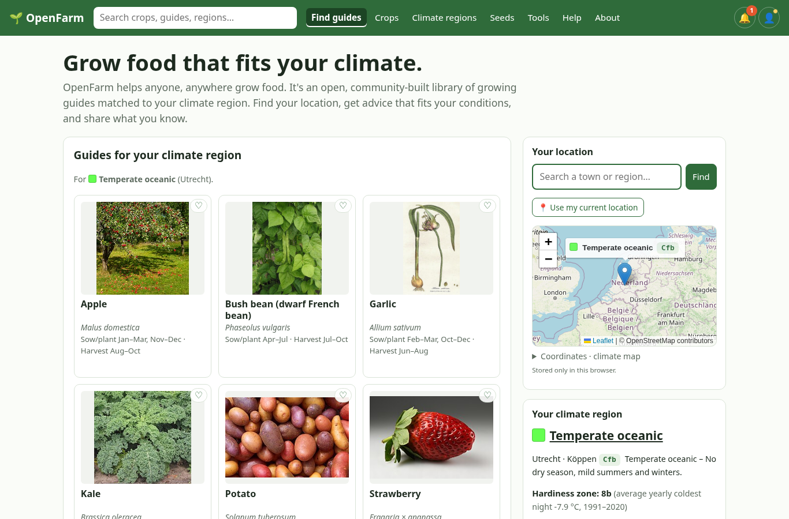
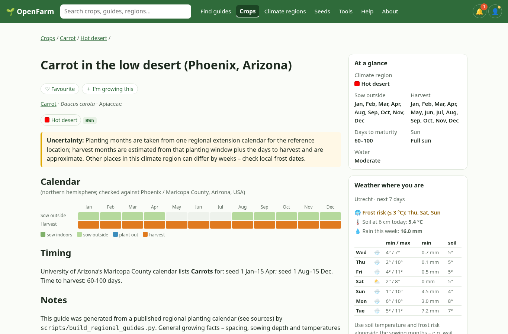
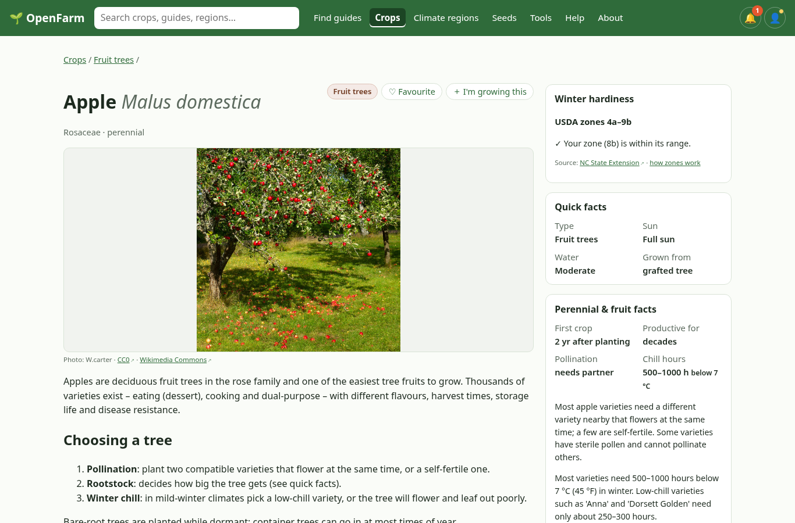
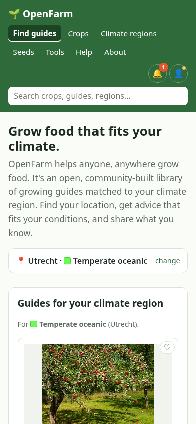

# 🌱 OpenFarm

*Growing guides for you.*

**Open, community-built growing guides matched to your climate region. Find your place, get a
calendar that fits, and share what you know.**

👉 Live demo: **https://karimogit.github.io/OpenFarm/**

Pick a place on the map (or search, or type lat/lon) → OpenFarm looks up its
**Köppen-Geiger climate class** in your browser and maps it to one of **15 climate regions**
that together cover every place on Earth → you get the guides written for your climate region,
a month-by-month calendar (hover a coloured month for spacing, sun, days or a listed tool, when the guide has them), a 7-day forecast with frost risk and soil temperature, varieties that
suit your region and seed sources near you. No accounts, no backend, no tracking.

| | | | |
|---|---|---|---|
|  |  |  |  |

## Why

Most planting calendars are written for one country, and most "zone" systems
(USDA hardiness zones) describe only winter cold. A gardener in the Netherlands, in
Umeå, in Seville and in Bangkok needs completely different advice for the same crop,
and the differences come from the *whole* climate: summer heat, dry seasons and
season length. The Köppen-Geiger classification captures exactly that and covers the
whole planet, so it works as a shared key for organising guides worldwide.

## What's in this repository

```
content/crops/<crop>.md                       A crop: facts true everywhere (type, family, seed saving, perennial facts)
content/varieties/<crop>/<variety>.md         A variety/cultivar: maturity, tolerances, resistance, its seeds block
content/guides/<crop>/<region>.md             How to grow one crop in one climate region: calendar, spacing, varieties, problems
content/regions/<region>.md                   The 15 climate regions, their Köppen classes, colour and "most similar" order
content/problems/<problem>.md                 Pests, diseases and disorders – written once, linked from every crop they affect
content/seed-sources/<source>.md              Seed libraries, networks, gene banks and companies, by country
content/companions.yaml                       Companion-planting pairs with an evidence level (published sources only)
content/rotation.yaml                         Crop rotation groups and rules
content/sources.yaml                          Citation registry – reuse a source by key; each entry has license and use
SOURCES.md                                    Source and licence policy (import allowlist, citations, wiki-data rule)
schema/*.schema.json                          JSON Schema for every file type – validated in CI
data/images.json                              Wikimedia Commons photo + author + license per crop/variety
data/koppen/                                  Köppen-Geiger 0.5° grid, Beck et al. 2018 (CC BY 4.0)
data/country-climates.json                    Derived country climate-region shares (committed so CI need not run GIS)
data/grin-edibility.json                      GRIN Taxonomy matches applied to crops (public domain; dump not shipped)
scripts/validate.js                           Schemas + cross-references + region coverage (npm run validate)
scripts/audit_pages.mjs                       Built HTML + guide coverage report (npm test, after Eleventy)
scripts/backfill_guide_fields.mjs             Backfill spacing/depth/soil from prose or crop records (--write)
scripts/import_rescue.js                      Imports the CC0 openfarm-crops-rescue dataset (npm run import:rescue)
scripts/fetch_images.js                       Finds freely licensed Commons photos (npm run images)
site/                                         Eleventy templates, CSS and small vanilla-JS modules (MIT)
```

Public URLs (the site is served under `/OpenFarm/` on GitHub Pages):

- Crop: `/crops/<crop>/` · variety: `/crops/<crop>/<variety>/` · variety group: `/crops/<crop>/<group>/`
- Growing guide: `/crops/<crop>/<region>/` (variety-specific: `/crops/<crop>/<variety>/<region>/`). Old `/guides/…` URLs redirect.
- Tools: `/tools/<tool>/` and category pages `/tools/<category>/`
- Climate region: `/regions/<region>/` · country: `/countries/<iso2>/` · city: `/places/<slug>/` (for example `/places/amsterdam-nl/`) · hardiness zone: `/zones/<zone>/` (1a–13b)
- Readable location links: `?place=<city-slug>-<iso2>` (for example `?place=amsterdam-nl`) still work; the same slugs are used for city pages when one exists. The climate sidebar links the country page when a country code is known
- JSON API: `/api/` (docs), `/api/all.json`, `/api/guides.json`, `/api/tools.json`, `/api/countries.json`, `/api/places.json`, `/crops/<crop>.json`, `/regions/<region>.json`, `/countries/<iso2>.json`, `/places/<slug>.json`, `/zones/<zone>.json`


**Today:** 347 crops (84 curated, 263 imported; 208 with a sourced GRIN edible use), 194 varieties and
16 variety groups, 306 sourced guides, 38 tools, 15 climate regions covering all 31 Köppen-Geiger
classes, country pages for 252 GeoNames countries and territories, and hardiness-zone pages for
USDA-style zones 1a–13b. 96 crops are fruit, fruit trees, berries or nuts. Twelve of the 15 regions
currently have at least one guide (tropical rainforest has three). Subpolar oceanic, subtropical highland
and tundra still have none.
Curated guides cite public sources (RHS, University of Minnesota Extension, Colorado State
University Extension, University of Arizona, Clemson HGIC, UC ANR, UF/IFAS, University of Hawaiʻi
CTAHR, Jordbruksverket and others) and carry an honest `confidence` rating and `uncertainty` note.

### Climate regions

The 31 Köppen-Geiger classes are grouped into 15 climate regions that gardeners can recognise:

| Region | Köppen classes | Region | Köppen classes |
|---|---|---|---|
| Tropical rainforest | Af | Humid subtropical | Cfa, Cwa |
| Tropical monsoon | Am | Subtropical highland | Cwb, Cwc |
| Tropical savanna (wet and dry) | Aw, As | Temperate oceanic | Cfb |
| Hot desert | BWh | Subpolar oceanic | Cfc |
| Cold desert | BWk | Humid continental | Dfa, Dfb, Dwa, Dwb, Dsa, Dsb |
| Hot semi-arid steppe | BSh | Subarctic (boreal) | Dfc, Dfd, Dwc, Dwd, Dsc, Dsd |
| Cold semi-arid steppe | BSk | Tundra and polar | ET, EF |
| Mediterranean | Csa, Csb, Csc | | |

When a crop has no guide for your region, the site shows the guide from the **most similar
region** (each region lists its `similar` regions in order), clearly labelled
"nearest region – not written for yours", with a link to add a guide for your region.

### URLs and JSON

| Page | JSON |
|---|---|
| `/crops/<crop>/` | `/crops/<crop>.json` |
| `/crops/<crop>/<variety>/` or `/crops/<crop>/<group>/` | (inside the crop JSON) |
| `/crops/<crop>/<region>/` (legacy `/guides/…` redirects) | (inside the crop JSON; also `/api/guides.json`) |
| `/regions/<region>/` | `/regions/<region>.json` |
| `/countries/<iso2>/` | `/countries/<iso2>.json`, index `/api/countries.json` |
| `/places/<slug>/` | `/places/<slug>.json`, index `/api/places.json` |
| `/zones/<zone>/` | `/zones/<zone>.json` |
| `/problems/<problem>/`, `/tools/<tool>/`, `/crops/#seed-sources`, `/search/` | `/api/all.json`, `/api/guides.json`, `/api/tools.json` |

## Confidence

Every guide has a `confidence` of `high`, `medium` or `low` in its frontmatter (also in the JSON API). This is for maintainers and is not shown on the public guide pages:

- **high** – at least two sources from *different publishers* agree, at least one written for a place inside the guide's Köppen classes (the `reference_location`), and `last_reviewed` is within the last three years.
- **medium** – at least one regional source (extension service, national horticultural society, government or research body writing for a place in this climate), but not enough for high.
- **low** – timing adapted from a source for a different or broader climate, or a single general (non-regional) source.

`npm run validate` enforces the mechanical part: `high` fails with fewer than two distinct publishers or a review older than three years. Whether a source is regional is checked in review. Confidence is not shown on the public site (cards, overviews or guide pages).

## Hardiness zones

USDA-style zones (average yearly extreme minimum temperature; zone 1 starts at −60 °F, 10 °F per zone, a/b halves).
The visitor's zone is computed in the browser from the [Open-Meteo historical weather API](https://open-meteo.com/en/docs/historical-weather-api)
(ERA5 reanalysis, ~25 km, CC BY 4.0): the coldest daily minimum of each year 1991–2020, averaged, cached in localStorage.
Limits: the coarse grid smooths frost pockets, valleys and urban heat, and reanalysis is often slightly milder than station data in cold spots.
Crop ranges (`hardiness: {min, max, sources}`) come only from cited sources (currently NC State Extension's Plant Toolbox,
filled by `scripts/fetch_hardiness.py`, which only accepts a page whose heading names the same species). No zones are estimated.
Each half-zone page lists every catalogue crop whose sourced range includes that half-zone. Crops with no sourced range are left off. A whole-zone number such as 8 covers both 8a and 8b.

## Your profile, reminders and privacy

Exports on the Profile page: **JSON** (full backup, re-importable), **CSV** (favourites and growing list with notes), **.ics** (sow/plant/harvest reminders) and **Markdown** (a readable garden notebook). See also the in-site [Help](https://karimogit.github.io/OpenFarm/help/) page.


- **Local profile, no account.** Your location, favourites (the heart on crops, varieties, guides and tools) and "What I'm
  growing" list (with sow dates and notes) are stored only in your browser's `localStorage`
  (key `openfarm.profile`, versioned JSON). Nothing is sent to a server. Changes autosave immediately (notes after a short pause), with a brief “Saved” notice, and stay in sync across open tabs. The profile page can export it (JSON, CSV, calendar, Markdown),
  import a JSON backup (the shape is validated) and clear it. “What I'm growing” has a Cards/Calendar view switch. Add opens a crop/variety search, and a card opens a dialog to edit variety, dates, bed, quantity, status and notes.
- **Reminders.** Worked out in the browser from your growing list, your climate region's calendar and the
  Open-Meteo forecast: "Sow tomatoes indoors this month", "Frost forecast Thursday", "Dry week ahead – water …".
  You can opt in to browser notifications with a click (never asked on page load).
- **Limits.** OpenFarm is a static site with no push server, so reminders and notifications only appear while
  the site is open or when you come back to it. For reminders while the site is closed, use **Export to calendar
  (.ics)** on the profile page: it creates yearly all-day events for each sowing, planting, pruning and harvest
  window, with a 09:00 alert, which your phone or computer calendar shows on its own.
- **Third parties contacted by your browser:** OpenStreetMap tiles and Nominatim (map and place search – only when
  you search; the header only looks up places when you choose "Find place"), Open-Meteo (forecast for your saved
  coordinates) and Wikimedia (photos).

## Data model rationale

- **Crop → varieties → guides.** A *crop* holds facts that are true everywhere; a *variety*
  holds what differs between cultivars; a *guide* holds only what changes with the climate
  (calendar, spacing, which varieties and problems matter there). Nothing is repeated in
  every guide any more – the old guides each copied the scientific name, family and companions.
- **Seeds are split three ways.** How a *species* is pollinated, how far to isolate it and how
  long seed stays viable is botany, so it lives on the crop (`seed_saving`). Whether a
  *variety* is open-pollinated, F1 or clonal – and so whether saved seed comes true – lives on
  the variety (`seeds`), overriding the crop default. *Where to get seed* changes by country,
  not by climate, so seed sources are their own files with a `countries` list, and the site
  puts the ones serving your country first. Climate-specific seed timing goes in the guide
  (`seed_saving_note`).
- **Problems and companions are shared.** Late blight hits tomatoes and potatoes in every wet
  climate; writing it once in `content/problems/` with an `affects` list keeps the advice and
  sources consistent, and a guide just lists which problems matter locally. Companion pairs
  live once in `content/companions.yaml` with an evidence level (research / extension-advice /
  traditional), because most companion claims are folklore and should say so.
- **Sources are a registry.** `content/sources.yaml` lets many files cite the same RHS or
  extension page by key, so a moved URL is fixed in one place.
- **Regions are data, not code.** Region names, colours, Köppen classes and fallback order
  live in `content/regions/`, so they can be reviewed and changed like any other content, and
  CI checks that every Köppen class belongs to exactly one region.
- **Imported data is marked.** The 263 crops imported from the rescue dataset keep their CC0
  license, an `origin: imported` flag and the raw rescue fields, and are shown as unreviewed
  until someone curates them (`origin: curated`). The importer never overwrites curated files.
  Wiki-derived rescue fields (spacing, prose, sun, sowing) are not treated as an authority.
- **Variety groups.** Cultivar groups (for example garlic Hardneck Group and Softneck Group) are
  `kind: group` records under `content/varieties/<crop>/`, at `/crops/<crop>/<group>/`. Scientific
  names use sourced ICNCP forms only; ranks are not invented. Extra cultivar pages imported from
  Wikidata (CC0) record the name and taxon string only. They do not add spacing, sun, sowing,
  hardiness, or companions. OpenPlantDB's bulk file and the Wind River seed-catalogue compilation
  were reviewed and not imported; see [SOURCES.md](SOURCES.md).
- **Edibility.** `edible` / `edible_parts` and recorded poisonous uses come from USDA-ARS GRIN
  Taxonomy economic uses (public domain), cited per record, and are omitted when unsourced. They
  are for cultivated crops, not for identifying wild plants or foraging.
- **Countries.** `/countries/<iso2>/` pages use GeoNames names and cities (CC BY 4.0) and
  approximate climate-region shares from the Beck et al. 2018 0.5° grid (CC BY 4.0) assigned with
  Natural Earth 50m boundaries (public domain). Tiny territories use a city sample instead of an
  area share. The page opens with an interactive Leaflet map (Köppen overlay, simplified Natural
  Earth outline, legend with region links, view fitted to the principal land cluster) and a static
  SVG fallback. A data-only “Grows well here” list shows crops that have a sourced guide for one
  of the country’s listed climate regions; it is not a list of traditional crops, and it does not
  invent country hardiness zones.
- **Places.** `/places/<slug>/` pages (for example `/places/amsterdam-nl/`) use the same slugs as
  `?place=` links. Standing pages cover each territory’s capital (when it is in GeoNames
  cities15000) and the up to 12 most populous cities already listed on the country page; other
  GeoNames cities still work with `?place=` and search. A city page has a map pin, the Köppen
  region at that point (Beck et al. 2018, CC BY 4.0), a hardiness zone *derived* from Open-Meteo
  ERA5 1991–2020 (CC BY 4.0; official USDA 5 °F half-zone bounds; not an official USDA map), a
  country link, the same data-only “Grows well here” rule, and a sowing/harvest calendar taken
  from sourced regional guides.

### Guide format

```yaml
crop: potato
region: temperate-oceanic
title: Potatoes in mild oceanic climates (Netherlands, UK, Belgium)
koppen: [Cfb, Cfc]
hemisphere: north
reference_location: Netherlands / UK lowlands
calendar: { plant: [3, 4, 5], harvest: [6, 7, 8, 9, 10] }
spacing: { in_row_cm: [30, 37], between_rows_cm: [60, 75] }
sowing_depth_cm: [2, 5]
soil: { drainage: free-draining, notes: "Light, stone-free soil." }
sun: full
water: moderate
watering_note: "Keep moist until germination."
problems: [late-blight]
confidence: high
sources: [{ title: "Potatoes: grow your own", publisher: RHS, url: https://www.rhs.org.uk/vegetables/potatoes/grow-your-own }]
license: CC-BY-SA-4.0
```

Full field reference: [`schema/`](schema/) and [`content/TEMPLATE.md`](content/TEMPLATE.md).

## How this differs from the original OpenFarm

[OpenFarm](https://github.com/openfarmcc) (openfarm.cc), started by Rory Aronson,
was a free and open database of crowd-sourced growing guides. It inspired a lot of
people, including us, and this project would not exist without it. Its lessons shaped
this restart:

- **Content first, not app first.** The original needed a large web app before the
  database could become useful. Here the guides *are* the product: plain files that
  are readable and useful even without the website.
- **Git + Markdown instead of a database.** Every change is a reviewed pull request
  with full history, attribution and easy forking. Anyone can mirror or reuse the
  whole dataset with `git clone`.
- **Climate-based.** Guides are keyed to Köppen-Geiger classes and hemisphere, not
  just USDA zones, so the same crop gets different calendars in Utrecht, Umeå, Seville
  and Bangkok.
- **Sourced and honest.** Every guide links real sources. Maintainers record a confidence
  rating in the file (and JSON API) so weak guides can be found and improved.
- **Tiny and cheap to run.** A static site on free hosting – nothing to keep alive,
  no servers to pay for.
- **AI-assisted tooling, human-reviewed content.** Modern tools make it fast to draft
  guides, translate them and build features, but CI validation and human review keep
  quality up.

## Related projects

We'd rather cooperate than compete:

- **[Growstuff](https://www.growstuff.org/)** – a long-running open-source community
  for food gardeners that shares openly licensed crop data. Great for tracking plantings
  and harvests.
- **[OpenPlantDB](https://github.com/cwfrazier1/openplantdb)** – a machine-readable garden-plant dataset whose repository licence is CC0. The bulk file (39,124 records, checked 12 November 2026) was not imported: every source URL points at a seed shop or nursery, and the other rows do not link the number or sentence. See [SOURCES.md](SOURCES.md).

## Roadmap

- [x] Guide format, JSON Schema and CI validation
- [x] Offline location → Köppen lookup, monthly calendar, mobile-friendly static site
- [x] First 19 sourced guides across 5 crops and 4 climate groups
- [x] All 31 Köppen classes in 15 climate regions, with nearest-region fallback
- [x] Crop → variety → guide data model; seeds, problems, companions and seed sources as shared files
- [x] 263 crops imported from the CC0 rescue dataset; Commons photos; Pagefind search; Open-Meteo weather
- [x] 179 regional guides from extension planting calendars (Arizona, Clemson, UF/IFAS, Iowa State, Colorado State, Alaska Fairbanks)
- [x] Hardiness zones (Open-Meteo ERA5), tools, help page, profile export (JSON, CSV, .ics, Markdown)
- [ ] Guides for the regions that still have none (subpolar oceanic, subtropical highland and tundra)
- [ ] Review imported crops one by one and promote them to `origin: curated`
- [ ] Upgrade climate data to Beck et al. (2023) 1991–2020 at 0.1° (also CC BY 4.0)
- [ ] Native southern-hemisphere variants (instead of the shifted calendar)
- [ ] 50 crops × major climate groups; regional reviewers per climate
- [ ] Translations (Dutch, Swedish, Spanish, …) – the structured format makes this easy
- [ ] Frost-date and day-length hints; climate-change view (2041–2070 Köppen maps)
- [x] Public JSON export (`/api/all.json`, one JSON file per crop and region)
- [x] Wikidata CC0 taxonomy for extra food crops and cultivar names (names only; no growing advice). OpenPlantDB's bulk file and the Wind River seed-catalogue compilation were reviewed and left out; see [SOURCES.md](SOURCES.md)
- [ ] **Offline ZIM for Kiwix:** for major tagged releases, a release-triggered GitHub Action will build an offline OpenFarm ZIM (relative links, small bundled Commons images with attribution, Kiwix search instead of Pagefind, graceful offline behaviour for location, calendar and profile). The action will run zimwriterfs and zimcheck and attach the `.zim` to the GitHub release; a later step is to submit it to the Kiwix library.

## Sustainability

- **Hosting costs almost nothing:** a static site on GitHub Pages (or any static host).
  If the project moves to `openfarm.cc`, set `PATH_PREFIX=/` in the deploy workflow.
- **Low maintenance:** no database, no user accounts, no server to patch. If the website
  stopped tomorrow, the guides would still be usable straight from the repository.
- **Community governance:** the guides are reviewed through pull requests, with
  maintainers for each climate region over time.

## Development

```bash
npm ci
npm run validate        # check every content file against schema/ + cross-references
npm run dev             # http://localhost:8080/OpenFarm/ (search needs a full build)
npm run build           # validate + Eleventy + Pagefind search index into _site/
npm run import:rescue   # re-import the rescue dataset (never touches curated files)
npm run images          # refresh data/images.json from Wikimedia Commons
```

Node 20+. The climate assets in `site/assets/` are committed; rebuild them with
`npm run build:climate` (Python 3 + numpy + pillow) only if the source grid changes.

### Deploying (GitHub Pages)

1. The repository must be **public** (Pages on private repos needs a paid plan).
2. **Settings → Pages → Build and deployment → Source: GitHub Actions.**
3. Push to `main`. The *Deploy to GitHub Pages* workflow publishes the site to
   `https://karimogit.github.io/OpenFarm/`.

## Sources and licences

Content is CC BY-SA 4.0; code is MIT. We only *import* (copy or adapt) data from public
domain/CC0, CC BY or CC BY-SA sources. NC, ND, all-rights-reserved, unclear and copyleft
code licences are not imported. Extension and RHS pages are usually *cited* rather than
copied. Wiki-derived rescue data is not treated as an authority. Edible-part fields, when
present, are cited and are not for foraging. Each record names its sources; contributor
credits come from git history. Full policy, allowlist and exclusions: [SOURCES.md](SOURCES.md).

## Licenses and credits

- **Code:** [MIT](LICENSE) – © 2026 OpenFarm contributors.
- **Content** (`content/`): [CC BY-SA 4.0](content/LICENSE) – attribute as "OpenFarm contributors".
  You may reuse and adapt it, also commercially, with attribution, under the same license.
- **Imported crop records:** [openfarm-crops-rescue](https://github.com/thefullnacho/openfarm-crops-rescue)
  (data recovered from the original OpenFarm.cc via the Wayback Machine), **CC0 1.0**. Files carrying
  `license: CC0-1.0` stay CC0.
- **Climate data:** Beck, H.E. et al. (2018), *Present and future Köppen-Geiger climate
  classification maps at 1-km resolution*, Scientific Data 5:180214,
  [doi:10.1038/sdata.2018.214](https://doi.org/10.1038/sdata.2018.214) –
  [CC BY 4.0](https://creativecommons.org/licenses/by/4.0/). See [`data/koppen/`](data/koppen/README.md).
- **Photos:** [Wikimedia Commons](https://commons.wikimedia.org/) – each photo shows its author and
  license (CC0, public domain, CC BY or CC BY-SA only); details in `data/images.json`.
- **Weather:** [Open-Meteo.com](https://open-meteo.com/), CC BY 4.0 – fetched in the browser, no key.
- **Map tiles and Nominatim fallback:** © [OpenStreetMap](https://www.openstreetmap.org/copyright)
  contributors, via the OSM tile server and Nominatim (used within their usage policies).
- **Offline place search and country names:** [GeoNames](https://www.geonames.org/) gazetteer (`countryInfo`, `cities15000`, `admin1CodesASCII`), [CC BY 4.0](https://creativecommons.org/licenses/by/4.0/). Built by `npm run places` into `data/places.json`.
- **Country boundaries (climate shares only):** [Natural Earth](https://www.naturalearthdata.com/) Admin 0 1:50m, public domain. The shapefile is not shipped; derived shares are in `data/country-climates.json`.
- **Edibility:** [USDA-ARS GRIN Taxonomy](https://npgsweb.ars-grin.gov/gringlobal/taxon/taxonomysearch) economic uses, public domain (GRIN-Global FAQ). The bulk dump is not shipped; matches are in `data/grin-edibility.json`.
- **Interface icons:** [Lucide](https://lucide.dev/), ISC License.
- **Country flags:** [flag-icons](https://github.com/lipis/flag-icons) by Panayiotis Lipiridis, MIT License.
- **Leaflet:** BSD-2-Clause. **Pagefind:** MIT.

The site carries no advertising, affiliate links or tracking pixels. Advice in the guides is general.
Always check local conditions and local advice. Imported crop data is unreviewed – never use it to
decide whether a plant is safe to eat.
